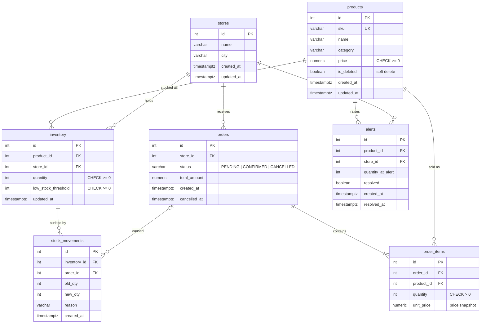

# Database schema (ER diagram)

Source of truth: [`migrations/001_init.sql`](../migrations/001_init.sql). The diagram renders automatically on GitHub.

## Constraints worth knowing

| Constraint | Purpose |
|---|---|
| `UNIQUE (inventory.product_id, inventory.store_id)` | One stock record per product-store pair (FR-03) |
| `CHECK (inventory.quantity >= 0)` | Second line of defence against negative stock (BR-1) |
| `UNIQUE (order_items.order_id, product_id)` | Same product cannot appear twice in an order (BR-6) |
| `UNIQUE INDEX uq_open_alert ON alerts (product_id, store_id) WHERE resolved = FALSE` | At most one open alert per product per store, even under concurrency (BR-4) |
| `products.sku UNIQUE` | SKU uniqueness (FR-01); stays reserved after a soft delete |
